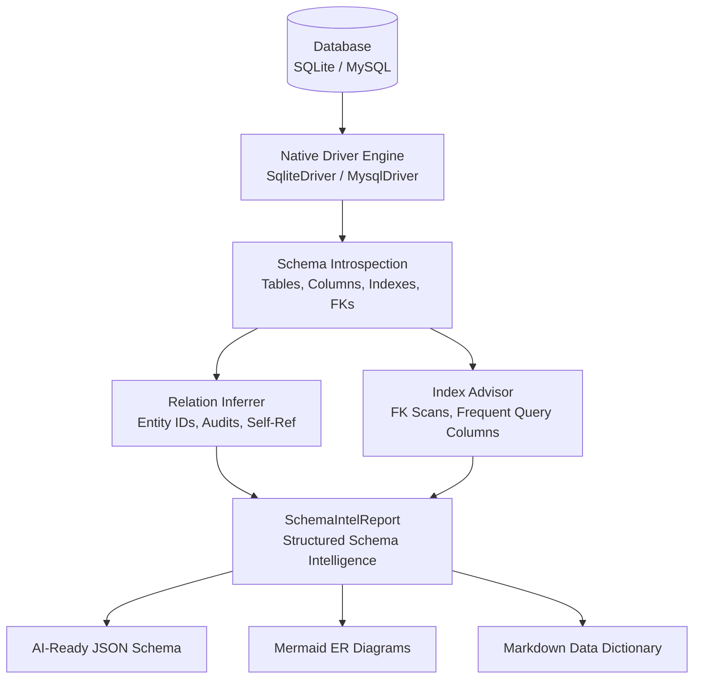
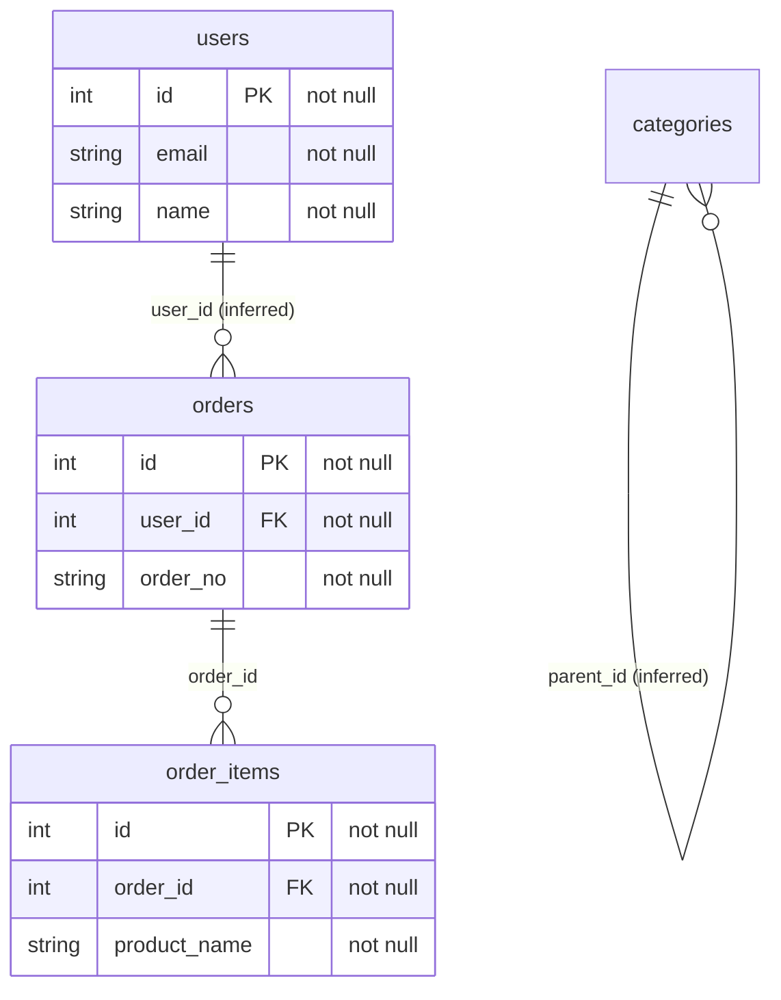

[🇸🇦 العربية](README.ar.md) | [🇬🇧 English](README.md)

# 🗄️ eidcloud-schema-intel

> Database Schema Intelligence & Introspection Engine with relation inference, missing index detection, and Mermaid ER diagram generation in pure PHP.

`eidcloud` `database-schema` `schema-introspection` `er-diagram` `index-advisor` `sqlite` `php8`

[](https://github.com/mhds-alhasan/eidcloud-schema-intel/releases)
[](https://php.net)
[](LICENSE)
[](https://colab.research.google.com/github/mhds-alhasan/eidcloud-schema-intel/blob/main/notebooks/quickstart.ipynb)

---

## ⚡ Overview

**eidcloud-schema-intel** is a zero-dependency database schema intelligence engine. It directly reverse-engineers MySQL, MariaDB, and SQLite databases using native information schema and pragmas. Beyond simple introspection, it automatically infers implicit relationships from conventions, pinpoints missing indexes on join columns and frequent query paths, and exports AI-ready JSON schemas, Markdown data dictionaries, and Mermaid ER diagrams (`erDiagram`).



---

## ✨ Features & Capabilities

- **Zero External Dependencies**: Pure PHP 8.2+ leveraging native PDO. No bloated ORMs or external packages required.
- **Multi-Engine Support**: Full direct introspection of **SQLite** (via `PRAGMA table_info`, `index_list`, `foreign_key_list`, `sqlite_master`) and **MySQL / MariaDB** (via `information_schema.TABLES`, `COLUMNS`, `STATISTICS`, `KEY_COLUMN_USAGE`).
- **Implicit Relation Inference**:
  - Automatically identifies unconstrained foreign keys (`user_id`, `post_id`, `customer_id`).
  - Detects self-referencing hierarchical relationships (`parent_id`, `manager_id`).
  - Infers ownership and audit relations (`created_by`, `updated_by`, `author_id` &rarr; `users`/`accounts`).
  - Detects business codes and references (`order_no`, `invoice_no`).
- **Missing Index Advisor**:
  - Highlights unindexed explicit and inferred foreign keys that cause full table scans on `JOIN`s and cascading deletes.
  - Suggests optimal index creation DDL statements for common query patterns (`email`, `status`, `slug`, `created_at`).
- **Visual & AI-Ready Exporters**:
  - Interactive **Mermaid ER Diagrams** (`erDiagram`) ready for documentation and PR reviews.
  - Structured, machine-readable **JSON Schema** tailored for Large Language Models (LLMs) and code generators.
  - Comprehensive **Markdown Data Dictionaries** with column statistics and index definitions.
- **Convenient CLI & Programmatic API**: Fast command-line interface (`bin/eidcloud-schema`) and clean PSR-4 object-oriented API.

---

## 📦 Installation

Clone the repository directly into your project or include it via Composer:

```bash
git clone https://github.com/mhds-alhasan/eidcloud-schema-intel.git
```

Or add to your `composer.json`:

```json
{
  "autoload": {
    "psr-4": {
      "EidCloud\\SchemaIntel\\": "src/"
    }
  }
}
```

---

## 🚀 CLI Usage

The tool ships with the standalone executable `bin/eidcloud-schema`:

```bash
php bin/eidcloud-schema <command> [options]
```

### Inspect Database & Output AI-Ready JSON

```bash
# SQLite
php bin/eidcloud-schema inspect --sqlite=app.sqlite --out=schema.json

# MySQL / MariaDB
php bin/eidcloud-schema inspect --mysql-db=my_app --mysql-user=root --mysql-pass=secret --out=schema.json
```

### Generate Mermaid ER Diagram

```bash
php bin/eidcloud-schema mermaid --sqlite=app.sqlite
```

Sample output:


### Run Missing Index Advisor

```bash
php bin/eidcloud-schema missing-indexes --sqlite=app.sqlite
```

Example output:
```
⚠️ Detected 2 missing index suggestion(s):

[1] Table: order_items | Columns: (order_id) | Severity: CRITICAL
    Reason: Foreign key column 'order_id' referencing 'orders' has no index (causes full table scans on JOINs/cascades)
    SQL:    CREATE INDEX "idx_order_items_order_id" ON "order_items" ("order_id");

[2] Table: users | Columns: (email) | Severity: HIGH
    Reason: Lookup column frequently used in authentication/search
    SQL:    CREATE INDEX "idx_users_email" ON "users" ("email");
```

### Generate Comprehensive Markdown Data Dictionary

```bash
php bin/eidcloud-schema dictionary --sqlite=app.sqlite --out=DICTIONARY.md
```

---

## 💻 Programmatic PHP API

```php
use EidCloud\SchemaIntel\SchemaInspector;

require_once __DIR__ . '/vendor/autoload.php';

// Inspect SQLite or MySQL
$inspector = SchemaInspector::fromSqlite('/path/to/database.sqlite');
// Or MySQL:
// $inspector = SchemaInspector::fromMysql(['database' => 'app', 'username' => 'root', 'password' => '']);

$report = $inspector->inspect();

// Access tables & columns
foreach ($report->tables as $table) {
    echo "Table: {$table->name} (" . count($table->columns) . " columns)\n";
}

// Inferred relationships
foreach ($report->inferredRelations as $relation) {
    echo "Inferred: {$relation->sourceTable}.{$relation->sourceColumn} -> {$relation->targetTable}.{$relation->targetColumn}\n";
}

// Export Mermaid ER
echo $inspector->toMermaid($report);

// Export AI-Ready JSON
echo $inspector->toJson($report);
```

---

## 🧪 Testing

Run the zero-dependency automated test runner:

```bash
php tests/run_tests.php
```

Output:
```
========================================
  eidcloud-schema-intel Test Runner     
========================================
Running SchemaIntelTest suite...
  [PASS] testIntrospection
  [PASS] testRelationInference
  [PASS] testMissingIndexDetection
  [PASS] testMermaidAndJsonExport
✅ All tests passed successfully!
```

---

## 👤 Author & Maintainer

**Eng. MHD. Shadi AL-Hasan**  
- **Role:** Executive CTO & Enterprise Solutions Architect  
- **Email:** [mhd.shadi.alhasan@gmail.com](mailto:mhd.shadi.alhasan@gmail.com)  
- **Phone / WhatsApp:** [+963934005922](tel:+963934005922)  
- **Location:** Damascus, Syria  
- **GitHub:** [shadialhasan](https://github.com/shadialhasan)  

---

## 📄 License

This project is licensed under the MIT License - see the [LICENSE](LICENSE) file for details.  
Copyright (c) 2026 **MHD. Shadi AL-Hasan**. All rights reserved.
